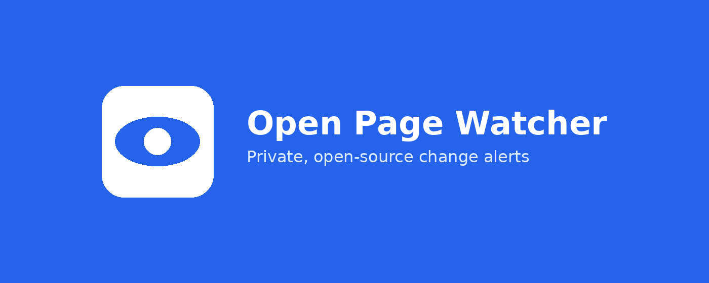
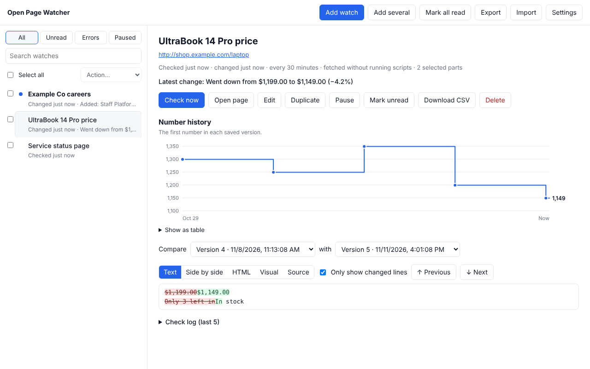
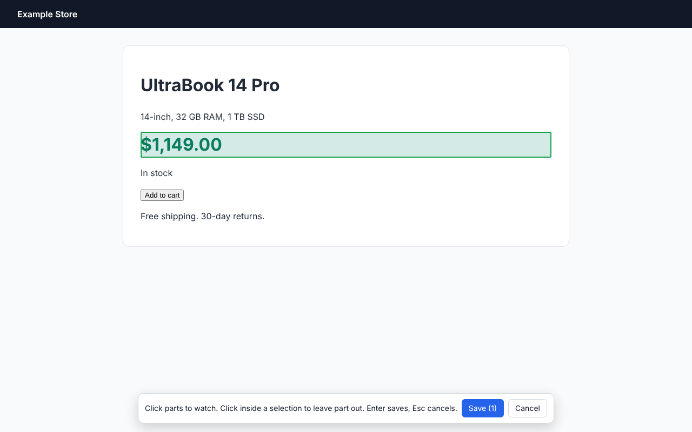
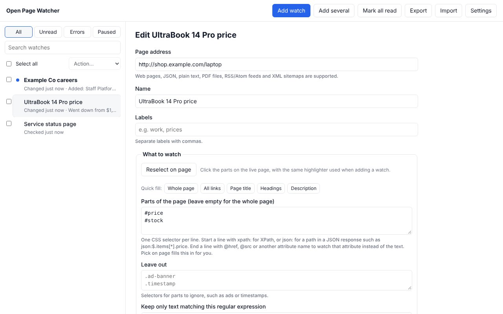
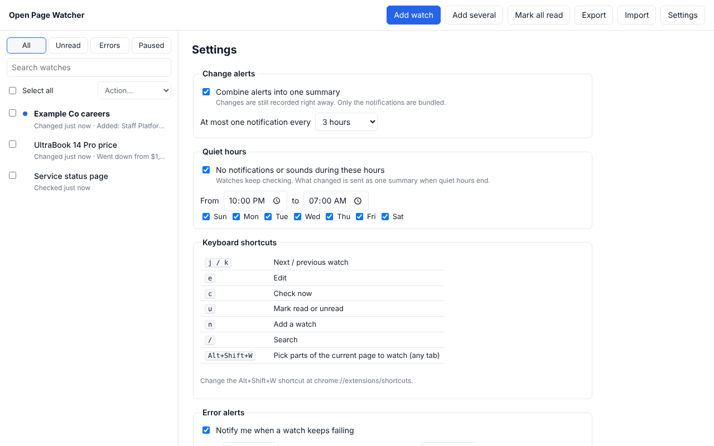

<p align="center">
  
</p>

# Open Page Watcher

A privacy- and security-first Chrome extension that watches web pages for
changes and alerts you, similar to other popular web monitors. Everything happens on
your computer: no servers, no accounts and no data collection of any kind.

**[Read the documentation](docs/README.md)** · **[Examples and use cases](docs/examples.md)** ·
[Selectors](docs/selectors.md) · [Regex](docs/regex.md) · [Alert rules](docs/alerts.md) ·
[Troubleshooting](docs/troubleshooting.md)

<p align="center">
  
</p>

## Screenshots

| Pick the parts of a page to watch | Choose what to watch and when to alert |
| --- | --- |
|  |  |
| **Quiet hours, combined summaries and shortcuts** | |
|  | |

## Private and local by design

Open Page Watcher is built on one rule: **your data stays on your device.**

- **Everything is local.** Your watches, the page versions it saves, its check
  log and your settings live only in your browser's own extension storage.
  Removing the extension deletes them.
- **No data collection.** No analytics, telemetry, tracking, crash reports, ads
  or accounts. The developer never learns which pages you watch or what's on
  them.
- **No servers.** The only network requests it makes are to the pages you ask it
  to watch, the same as opening them yourself.
- **Security first.** It asks for access to a site only when you watch it and
  gives it back when you stop. Pages are read without running their scripts
  unless you choose otherwise. Your cookies only ever go to the site being
  watched, and only for pages that need you to sign in.
- **Nothing hidden.** No remote code, no build step and no third-party
  dependencies, so the code in this repository is exactly what runs.

Features that would need your data to leave your computer, such as cloud sync,
email or SMS alerts and AI summaries, are deliberately left out and won't be
added. See [PRIVACY.md](PRIVACY.md) and the security model in
[docs/SPEC.md](docs/SPEC.md#security-model).

## Why

Popular page-monitoring extensions ask for access to every site, sync your data
to vendor servers and ship code you can't easily audit, which makes them hard to
approve for use at work. Open Page Watcher gives you the same core features
without those trade-offs.

This is a clean-room implementation written from scratch. It contains no code
from any other proprietary extension.

## Features

**Choosing what to watch**
- Watch a whole page, or click to select just the parts you care about, and
  click inside a selection to leave parts out (ads, timestamps)
- CSS and XPath selectors, attributes such as `@href`, and an optional regex to
  keep only matching text
- JSON paths such as `json:$.items[*].price` to watch just some values of a
  JSON API response
- Quick fills for all links, the page title, headings or the description
- Web pages, JSON, plain text, PDF files, RSS/Atom feeds and XML sitemaps
- Pages that need JavaScript can be rendered in a hidden window, including
  content inside frames. Every watch starts by downloading the page without
  running scripts; if that only gives a placeholder ("Internet Explorer is not
  supported", "enable JavaScript") or an empty app shell, nothing is saved and
  you're asked, for that watch, whether to read it in a hidden tab or try with
  your cookies
- Right-click any page or link to watch it, or press Alt+Shift+W to pick parts

**When to check**
- Add a whole list of addresses at once with the same schedule and labels
- Every minute up to every 7 days (drag a slider or type an exact value), or at
  a random time within a range
- Only during certain hours and days
- Instantly while the page is open in a tab (live mode)

**Pages behind a sign-in**
- Notices when a page asks you to sign in, instead of saving the sign-in page
  as a change, including pages that send you to a separate single sign-on site
- Once you're signed in, turns on your cookies for that watch by itself (you
  can switch this off)
- You choose what happens when a sign-in is needed: a notification, open the
  page in a tab so you can sign in, pause the watch, or nothing

**When to alert**
- Rules combined with all/any: text contains, starts or ends with, is empty,
  matches a regex, length, never seen before, number above or below, and number
  up or down by an amount or a percentage, checked on the new, added, removed or
  previous text
- Number limits: alert when a price or count is below or above a number, or
  only once when it drops below or rises above it. Type the limit the way you
  would write it (`1200`, `$1,200`, `1200 dollars`, `1.2k`). Prices like
  `1.299,00 €` and `12,50` are read correctly. If the text holds several
  numbers, give a regex such as `Price:\s*(\S+)` to say which one to read
- Alert only on bigger changes: more than a number of lines, or a percentage
  of the text
- Ignore changes that are only dates, numbers, letter case, spacing or the
  order of lines, and ignore lines containing some text or matching a regex
- Optionally (off by default) count formatting changes too: text turning bold
  or italic, becoming a heading, list item or table cell, links pointing
  somewhere else, and colors, sizes or hiding set in the page's own markup.
  The Formatting tab shows what changed
- Optionally count HTML changes: an element or attribute changing even when
  the words don't, like an "Add to cart" button becoming `disabled`, a class
  switching from `in-stock` to `sold-out`, or an image or link pointing
  somewhere new. Attributes that change on every visit (`data-*`, `style`) can
  be ignored. The HTML tab shows what changed
- Optionally compare screenshots of the watched parts (for pages opened in a
  hidden window), with a sensitivity setting. The Screenshot tab shows the
  older and newer pictures with the changed areas outlined. See
  [HTML and visual changes](docs/html-and-visual-changes.md) for examples
- Pause a watch after its first alert, for one-off events like a restock
- Notifications that say what changed ("Went down from $1,299 to $1,199
  (−7.7%), now below $1,200"),
  an optional sound (pick from six, with a preview), or the change read aloud
- Quiet hours, and an option to combine alerts into one summary
- An alert when a watch keeps failing

**Reviewing changes**
- Inbox with unread changes, labels, filters, search, bulk actions and keyboard
  shortcuts
- Text, side-by-side, formatting, HTML, screenshot, visual and source views of
  any two saved versions
- A chart of the number on the page over time
- Open the page with what changed highlighted
- A log of recent checks for each watch
- Download every saved version of a watch as a CSV file for a spreadsheet

**Keeping control**
- Password-protected backups (AES-256-GCM), plus plain JSON import and export
- IT teams can limit sites, intervals and options through Chrome policy (see
  [docs/enterprise.md](docs/enterprise.md))

See [docs/SPEC.md](docs/SPEC.md) for how this compares with other monitors'
features, what is deliberately left out, and the full security model.

## Install

1. Download the latest `open-page-watcher-vX.Y.Z.zip` from
   [Releases](https://github.com/miqueet/open-page-watcher/releases/latest) and unzip it.
2. Open `chrome://extensions` and turn on **Developer mode**.
3. Click **Load unpacked** and choose the unzipped folder (the one that contains `manifest.json`).

Each release also has a `.sha256` file so you can check the zip wasn't altered,
and a `-chrome-web-store.zip` ready to upload to the Chrome Web Store (see
[docs/chrome-web-store.md](docs/chrome-web-store.md)).

Managed work machines sometimes block unpacked extensions. In that case your IT
team can review this repository and publish it internally or allow-list it.

## Use

- On any page, click the toolbar icon and choose **Watch whole page** or
  **Select parts of page**. With the picker, click the elements you want (click
  again to deselect), then **Save**.
- To change what an existing watch looks at, open it in the inbox, click
  **Edit**, then **Reselect on page**. The page opens with the parts you chose
  before already highlighted; click to add or remove parts, press Enter, and
  you're taken back to the editor with the fields filled in. Nothing changes
  until you click **Save**.
- Chrome asks once per site for permission to read it. Watches on a site you
  haven't allowed show an **Allow** button in the inbox.
- Open the inbox from the popup to see changes, edit how often a page is
  checked, set alert conditions, or choose what happens when a page asks you to
  sign in.

New to it? [Getting started](docs/getting-started.md) walks through all of this,
and [Examples and use cases](docs/examples.md) has ready-made recipes.

## Documentation

The [docs folder](docs/README.md) explains how everything works, with worked
examples you can copy into the watch editor:

| Guide | Covers |
| --- | --- |
| [Getting started](docs/getting-started.md) | Installing, your first watch, the popup, inbox and editor |
| [How it works](docs/how-it-works.md) | What happens during a check, step by step |
| [Selectors](docs/selectors.md) | The picker, CSS, XPath, attributes, "Leave out" and JSON paths, with a cheat sheet |
| [Regular expressions](docs/regex.md) | The four places regex is used, with a cheat sheet and examples |
| [Alert rules and notifications](docs/alerts.md) | Every rule, including "notify me when the price drops below $1,200", sounds and spoken alerts |
| [Ignoring noise](docs/ignoring-noise.md) | Ignoring dates, numbers, case, spacing, line order and lines |
| [Loading pages](docs/loading-pages.md) | Download vs. hidden tab vs. live mode, sign-ins, PDFs, feeds, JSON |
| [Formatting changes](docs/formatting.md) | Alerts when text turns bold, becomes a heading or changes color |
| [HTML and visual changes](docs/html-and-visual-changes.md) | Alerts when elements, attributes or the way the page looks change, even if the text doesn't |
| [Reviewing changes](docs/reviewing-changes.md) | Comparison views, the number chart, CSV export, backups, shortcuts |
| [Examples and use cases](docs/examples.md) | 22 step-by-step recipes: prices, restocks, status pages, releases, jobs, policies, APIs |
| [Troubleshooting](docs/troubleshooting.md) | What every error means and how to fix it |

## Permissions

| Permission | Why |
| --- | --- |
| `storage`, `unlimitedStorage` | Save your watches and their history locally, without the 10 MB cap |
| `alarms` | Run checks on a schedule |
| `notifications` | Show change alerts |
| `offscreen` | Parse pages without running their scripts, and play the alert sound |
| `activeTab`, `scripting` | Inject the element picker into the tab you're on when you ask for it, read rendered pages, and highlight changes on a page you open from the inbox |
| `contextMenus` | The "Watch this page" right-click items |
| `tts` | Read changes aloud, if you turn that on for a watch (on-device voices only) |
| Site access (optional, per site) | Requested only for sites you watch, and released when you stop |
| Access to all sites (optional) | Only if you turn on screenshots for a watch: Chrome lets an extension screenshot a tab only with this. Given back when no watch takes screenshots. Checks still only load the pages you chose |

### Screenshots and "access to all sites"

Screenshot comparison is the only feature that needs more than access to the
sites you watch, and it is **off unless you turn it on** for a watch.

- **Why:** Chrome only lets an extension take a screenshot of a tab when it has
  access to all sites. Access to the individual site isn't enough (this was
  tested). There is no narrower permission that allows it.
- **When it's asked for:** only when you tick **Also compare screenshots** on a
  watch and save. Chrome shows its usual prompt; if you decline, nothing changes
  and the watch is not saved with screenshots on.
- **When it's given back:** as soon as no watch uses screenshots (you turn the
  option off or delete the watch), and again whenever Chrome starts if nothing
  uses it.
- **What it's used for while held:** taking a picture of the hidden window the
  extension opened for that watch's page. Nothing else. Checks, redirects and
  frames still only go to sites you added watches for; holding access to all
  sites never counts as permission to read another site.
- **For IT teams:** the `disableScreenshots` policy removes the option, so the
  extension never asks for access to all sites (see
  [docs/enterprise.md](docs/enterprise.md)).
- **If you'd rather not grant it:** leave screenshots off. **Also watch the
  HTML** and **Also watch formatting** catch many visual changes (a class,
  `disabled`, an image address, inline colors) with no extra permission.

See [HTML and visual changes](docs/html-and-visual-changes.md) for examples.

## Development

```sh
npm test                    # unit tests, no dependencies needed
PLAYWRIGHT=$(npm root -g)/playwright node test/e2e.mjs   # browser tests (needs Playwright + Chromium)
```

## Feature requests and feedback

Ideas are very welcome. If there's something you'd like Open Page Watcher to do,
[open a feature request](https://github.com/miqueet/open-page-watcher/issues/new?template=feature_request.yml).
Before you do, have a look at the
[open requests](https://github.com/miqueet/open-page-watcher/issues?q=is%3Aissue+is%3Aopen+label%3Aenhancement)
and give a 👍 to the ones you want, which helps decide what comes next.

Anything that keeps your data on your computer is in scope. Requests that would
need a server, an account or sending your data anywhere are not, for the reasons
above. Found a bug? [Report it](https://github.com/miqueet/open-page-watcher/issues/new?template=bug_report.yml).
The About section at the bottom of Settings links to both forms.
Security problems go through [SECURITY.md](SECURITY.md) instead.

## Support the developer

If you would like to support the developer, please feel free to donate here:

Bitcoin (BTC): `bc1qgkla5xl804l78dmukx80zerepgkxndmtk0pach`

The same address is in the extension under **Settings → About**, with a Copy button.

## Privacy

Nothing leaves your browser. See [PRIVACY.md](PRIVACY.md).

## License

[MIT](LICENSE)
testing
